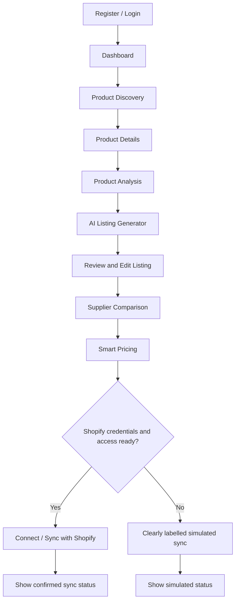
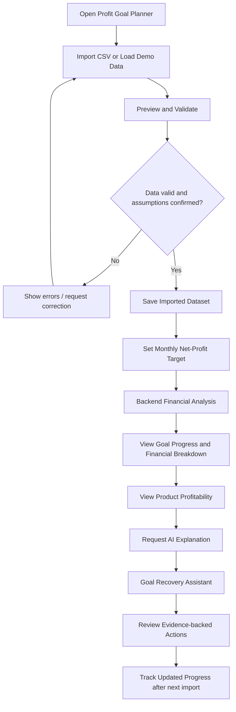
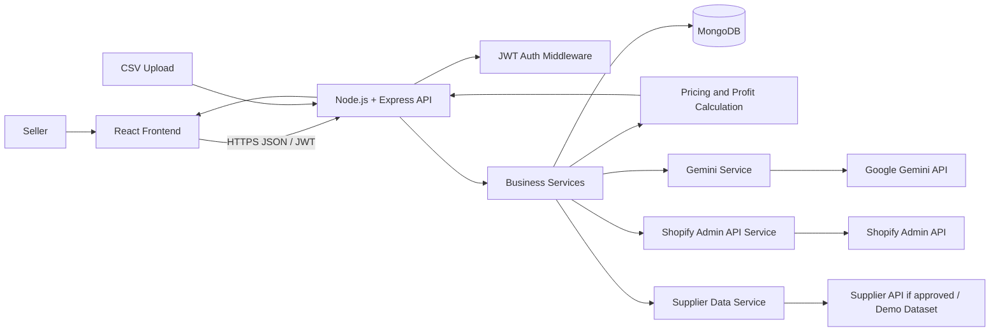
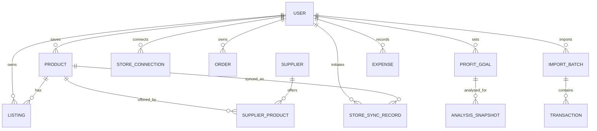
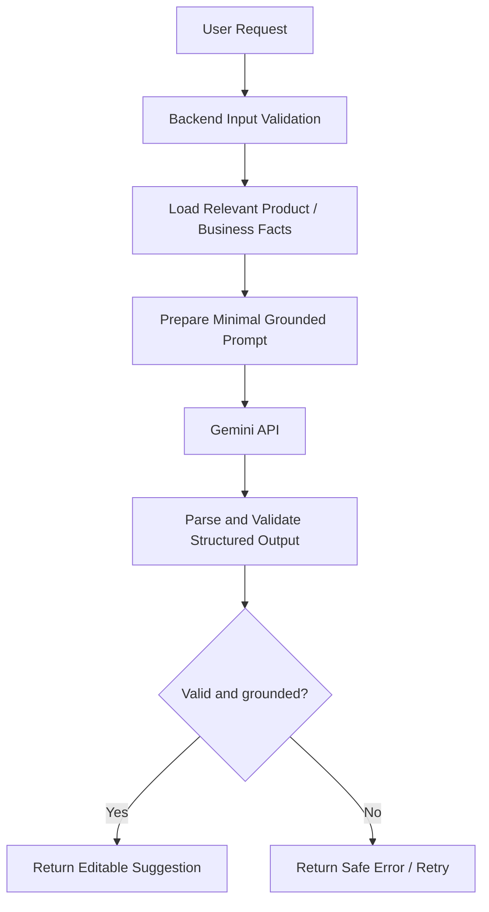
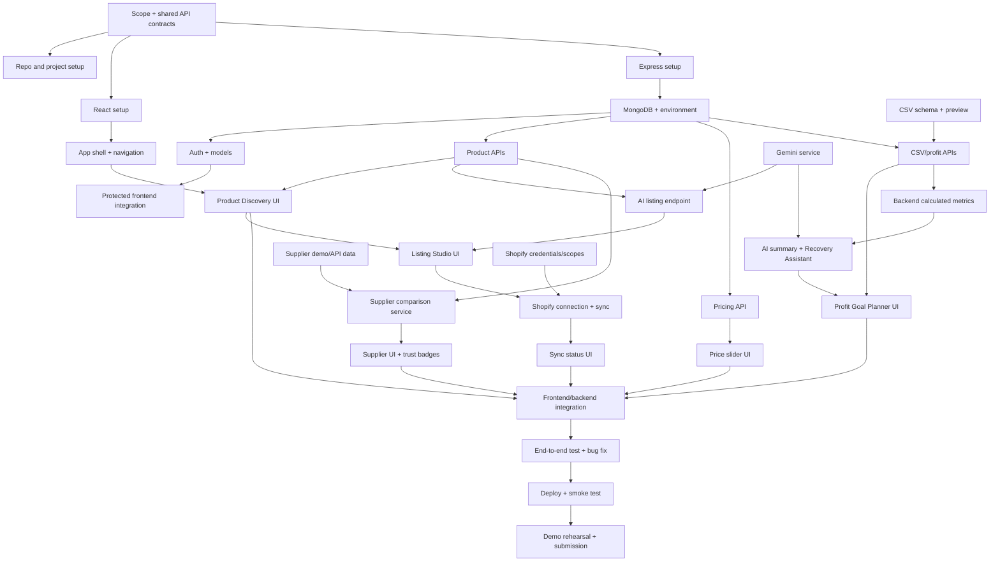

# DropPilot AI — Product Requirements Document (PRD) & 24-Hour Implementation Blueprint

> **Project:** DropPilot AI — AI-Powered Dropshipping Business Manager  
> **Category:** AI / E-commerce / SaaS  
> **Version:** 1.0  
> **Document status:** Draft for hackathon execution  
> **Last updated:** 13 November 2026  
> **Duration:** 24-hour hackathon  
> **Team size:** 4  
> **Repository/workspace:** Project root (repository URL TBD)  
> **Document owner:** Project team / project owner  
> **Authority:** This PRD is the detailed product and execution specification. `context.md` remains the approved technical and behavioural reference. If a conflict is found, do not silently override the approved context; resolve and document the decision.

---

## 0. How to Read This PRD

This PRD adapts the supplied reusable PRD structure to the DropPilot AI hackathon. It removes unrelated hardware/IoT sections and concentrates on product requirements, web architecture, AI behaviour, APIs, team execution, testing, and demonstration.

### Requirement status labels

- **Confirmed:** Agreed project scope or rule from `context.md`.
- **Planned:** Intended functionality/API that has not yet been implemented.
- **Assumption:** A practical working assumption for the 24-hour build; validate it with the project owner.
- **TBD:** A decision that must be made during setup. Do not invent a value.

### Implementation status

The project is at initial setup. This document describes intended behaviour; it does not claim that any application code, endpoint, integration, deployment, or credential is already available.

### Priorities

- **P0 — Must have:** Required for a credible end-to-end MVP.
- **P1 — Should have:** High-value feature if the P0 workflow is stable.
- **P2 — Could have:** Implement only if time remains after testing and integration.

---

# 1. Project Overview

## 1.1 One-line summary

DropPilot AI is a web-based dropshipping business manager that helps sellers discover products, create AI-assisted listings, compare suppliers, estimate pricing, synchronise products with Shopify, and understand profitability through data-grounded recommendations.

## 1.2 Background and context

Dropshipping entrepreneurs coordinate several activities across product research, supplier evaluation, listing creation, pricing, store publishing, and business performance monitoring. These activities may involve separate tools and manual data handling. DropPilot AI aims to bring the most useful parts of this workflow into one application and use AI for language generation and explanations.

The product is being developed as a 24-hour hackathon prototype by a four-person team. The build must favour a coherent, demonstrable workflow over a large collection of incomplete screens.

## 1.3 Problem statement

A dropshipping seller may need to:
- Find products worth investigating and review their available information.
- Turn product facts into a clear product listing and platform-specific marketing content.
- Compare suppliers on more than just unit price.
- Estimate a selling price after supplier, shipping, advertising, platform, and other costs.
- Publish a product to an online store.
- Understand whether the business is on track to meet a monthly net-profit target.

When these activities are spread across tools, the seller may spend time repeating work and may make decisions without a consolidated view of product costs and profitability. DropPilot AI addresses this workflow by combining product operations with a profit-analysis workspace. It does not guarantee product demand, sales, or profit.

## 1.4 Proposed solution

Build a React web application backed by a Node.js/Express API and MongoDB. The backend will manage business rules, authentication, data validation, financial calculations, and calls to Gemini and Shopify. The interface will present product discovery, listing generation, supplier comparison, pricing, store synchronisation, and profit-goal analysis.

For the hackathon:
- Use clearly labelled sample products and supplier records when live supplier access is not available.
- Use CSV imports and sample store data for the Profit Goal Planner.
- Attempt real Shopify synchronisation only if the Shopify app, credentials, permissions, and authentication flow are ready.
- Label simulated publishing or integrations as simulated; never present them as live.

## 1.5 Target users and stakeholders

| User / stakeholder | Description | Main needs |
|---|---|---|
| Dropshipping entrepreneur (primary) | Individual or small-team seller launching and operating an online store | Product discovery, listings, supplier comparison, pricing and store publishing |
| Existing dropshipping seller | Seller with sales and expense history | Monthly profit tracking, product-level analysis and corrective recommendations |
| E-commerce seller / online retailer | Seller operating an online catalogue | Faster content creation and clearer product economics |
| Digital agency | Agency managing one or more online stores | Repeatable content and product workflows; multi-store management is future scope |
| Hackathon judges / reviewers | Evaluate the prototype | Clear problem-solution fit, working demo, honest integration status and technical rationale |

The initial product should prioritise dropshipping entrepreneurs. Other customer groups are secondary.

## 1.6 Project goals and objectives

1. Deliver a working end-to-end product workflow from product discovery to listing and pricing.
2. Demonstrate useful Gemini-powered content generation grounded in supplied product facts.
3. Provide supplier comparison with transparent source and trust indicators.
4. Provide an accurate backend pricing calculator.
5. Demonstrate the Profit Goal Planner using imported or sample data, with financial arithmetic performed by backend code.
6. Provide a stable, honest demo that clearly distinguishes real, imported, sample, estimated, and simulated information.

## 1.7 Success metrics for the hackathon

These are prototype acceptance targets, not claims about commercial performance.

| Metric | Hackathon target | Measurement |
|---|---:|---|
| Core product journey | One complete demo path | Run discovery → listing → supplier comparison → pricing without a blocking error |
| AI listing generation | At least one valid editable result | Generate title, description, key features and SEO fields from supplied facts |
| Pricing correctness | All defined calculation test cases pass | Compare backend output against hand-calculated expected values |
| Profit Goal Planner | One valid CSV/sample dataset analysed | Show target, current net profit, remaining amount, progress and product performance |
| AI recommendations | Grounded response with limitations | Verify recommendations cite supplied figures and do not invent missing data |
| Integration transparency | 100% of demo data labelled | Inspect product, supplier, store-sync and profit-data source labels |
| Demo readiness | Repeatable final walkthrough | Complete rehearsed walkthrough within the presentation time |

## 1.8 Scope

### In scope

- User registration/login and protected API access using JWT.
- Product Discovery Grid with search, filters, product details and save capability.
- AI product analysis/explanation where supported by supplied data.
- AI Product Listing Generator.
- Supplier records and comparison, using real access if available or labelled demo records.
- Backend pricing calculation and Live Profit & Price Slider.
- Supplier Trust Badges based only on known evidence.
- Multi-Platform Content Generator for Shopify SEO, Instagram, and TikTok.
- Shopify connection and product sync if credentials and permissions are ready; otherwise a clearly labelled simulation.
- Profit Goal Planner using CSV import and/or sample store data.
- Goal Recovery Assistant based on backend-calculated results.
- Dashboard summary and charts where time permits.
- Error, loading, empty, and source-label states.

### Out of scope for the first hackathon MVP

- Guaranteed profit predictions or guaranteed business outcomes.
- Unverified claims about product demand, trends, supplier ratings, verification, stock, or delivery.
- Complex live integrations with multiple supplier marketplaces.
- Multi-store management.
- Full order fulfilment, shipping-carrier integrations, customer dispute handling, and returns automation.
- Payment/subscription billing and supplier commission processing.
- Advanced automation modules.
- A production-grade accounting or tax platform.
- Any feature that cannot be implemented and tested within the hackathon.

## 1.9 Business model context

Potential future revenue streams:
- Monthly subscriptions.
- Product research credits.
- Order processing fees.
- Supplier commissions or referral fees.
- Premium automation modules.

These are business-model possibilities only. Payments, billing, commissions, and subscription management are not hackathon requirements.

## 1.10 Market opportunity and differentiation

The opportunity is a consolidated workflow for sellers who currently move between product research, content creation, supplier checks, pricing tools, store administration, and spreadsheets. The market is competitive and success depends on reliable data and useful integrations; this PRD does not claim a quantified market size.

Potential differentiators:
- One workflow spanning product discovery through store publishing.
- Editable AI-generated listing and social content based on product facts.
- Supplier comparison that displays evidence, source, and freshness rather than unsupported trust claims.
- Transparent price/profit calculations.
- A Profit Goal Planner that uses actual backend calculations and explains performance in plain language.
- Clear distinction between live integrations, imported data, demo data, and estimates.

## 1.11 Assumptions and constraints

| Type | Assumption / constraint | Handling |
|---|---|---|
| Time | Exactly 24 hours are available | Freeze features before final 3-hour buffer |
| Team | Four contributors are available | Use one primary owner per workstream |
| Product data | Supplier APIs may not be available | Start with clearly labelled demo catalogue and supplier records |
| Store integration | Shopify credentials/scopes may not be ready | Implement only if setup is feasible; otherwise show a labelled simulation |
| Profit data | Live store data may not be accessible | CSV import and sample data are acceptable |
| Currency | Initial demo may use INR | Store currency explicitly; do not assume all future stores use INR |
| AI | Gemini API key/model selection are TBD | Keep calls server-side and handle failure gracefully |
| Deployment | Provider is TBD | Choose the simplest available deployment option during setup |
| Accounting | CSV columns and treatment of taxes/refunds/discounts are TBD | Define and disclose the selected rules before analysis |

---

# 2. Product Requirements

## 2.1 Functional requirements

| ID | Requirement | Priority | Acceptance summary |
|---|---|---:|---|
| FR-001 | The system shall allow a user to register, log in and access protected resources. | P0 | Valid credentials work; invalid credentials return safe errors; protected routes reject missing/invalid JWTs. |
| FR-002 | The system shall display a searchable and filterable product catalogue. | P0 | User can search, filter, open details and identify the data source. |
| FR-003 | The system shall provide product analysis based only on available product data. | P1 | Analysis identifies evidence, risks and missing data; no fabricated demand statistics. |
| FR-004 | The system shall generate editable product listing content using Gemini. | P0 | Output contains required fields and does not invent unsupported product facts. |
| FR-005 | The system shall list and compare supplier options for a product. | P0 | Comparison shows available costs, currency, availability, shipping estimate, rating/verification source and data source. |
| FR-006 | The system shall calculate estimated product profit and margin in backend code. | P0 | Valid inputs produce correct results; invalid or missing values are rejected. |
| FR-007 | The system shall allow users to adjust selling price and see updated estimates. | P1 | Slider/input refreshes displayed estimate using the documented formula. |
| FR-008 | The system shall display supplier trust indicators supported by known fields. | P1 | Unverified/demo suppliers are never shown as genuinely verified. |
| FR-009 | The system shall generate Shopify SEO, Instagram and TikTok content variants. | P1 | Each output is editable and grounded in supplied product facts. |
| FR-010 | The system shall connect to Shopify and synchronise a reviewed product when credentials and permissions are available. | P0 conditional | A real sync is marked successful only after Shopify confirms it; simulation is visibly labelled. |
| FR-011 | The system shall allow a seller to create/update a monthly net-profit goal. | P1 | Positive target, currency and month are validated and saved. |
| FR-012 | The system shall accept CSV store-performance data with preview and validation. | P1 | Invalid rows/columns are reported; user can review before import; missing expenses are not silently assumed to be zero. |
| FR-013 | The system shall calculate net profit, remaining target, progress, margins and product-level performance in backend code. | P1 | Results match deterministic test fixtures and disclosed accounting rules. |
| FR-014 | The system shall generate AI explanations and recommendations from calculated figures. | P1 | AI receives relevant validated metrics and returns evidence-linked recommendations and limitations. |
| FR-015 | The system shall provide a Goal Recovery Assistant for questions about performance. | P1 | Reasons and actions are grounded in imported/connected records; missing data is disclosed. |
| FR-016 | The system shall display dashboard summary and relevant charts. | P2 | Summary values include source labels; chart data matches backend responses. |
| FR-017 | The system shall clearly identify demo, CSV-imported, connected-store, estimated and simulated data. | P0 | Source labels are visible wherever users make decisions based on data. |
| FR-018 | The system shall provide useful loading, empty, validation, success and failure states. | P0 | No critical workflow leaves the user with a blank or misleading state. |

## 2.2 Non-functional requirements

| Category | Requirement |
|---|---|
| Performance | For the hackathon demo, normal local API requests should respond promptly; AI and external API calls must show loading states and handle timeouts. Exact numeric latency target is TBD after deployment environment is selected. |
| Reliability | A failure in Gemini, supplier data, MongoDB, or Shopify must not crash the whole application. Return a useful error and preserve user-entered data where practical. |
| Security | JWT-protected endpoints; validate inputs on the backend; keep API keys, passwords and Shopify tokens out of frontend bundles and source control. |
| Privacy | Send Gemini only the minimum relevant business/product data. Do not include secrets or unnecessary personal data in prompts or logs. |
| Data integrity | Store monetary amounts in integer minor units (e.g. paise) where practical, with currency explicitly recorded. Avoid binary floating-point for authoritative financial totals. |
| Usability | Main workflows should be understandable without reading technical documentation. Use consistent labels, clear actions and visible data-source indicators. |
| Accessibility | Use readable contrast, labels for inputs, keyboard-operable controls and meaningful button text where feasible within the prototype. |
| Maintainability | Separate React presentation, frontend API calls, Express routes/controllers, business services, models and external integration services. |
| Compatibility | Target a current desktop browser for the hackathon demo; responsive behaviour should be usable on common laptop and mobile widths where practical. Exact browser matrix is TBD. |
| Observability | Log useful diagnostic details without credentials, tokens, passwords or sensitive imported row contents. |
| AI quality | Validate structured model output on the backend; allow users to review and edit generated content. |

## 2.3 User stories

| ID | User story | Expected outcome |
|---|---|---|
| US-001 | As a seller, I want to create an account and sign in so that my workspace is protected. | Authenticated session and access to protected pages. |
| US-002 | As a seller, I want to search and filter products so that I can shortlist products to investigate. | Relevant catalogue results with source labels. |
| US-003 | As a seller, I want an AI explanation of a product's strengths and risks so that I can decide what to investigate next. | Explanation tied to available facts and limitations. |
| US-004 | As a seller, I want to generate an editable listing so that I can prepare a product page faster. | Editable title, description, features and SEO fields. |
| US-005 | As a seller, I want to compare suppliers so that I can assess cost and fulfilment trade-offs. | Side-by-side supplier information and evidence labels. |
| US-006 | As a seller, I want to adjust my selling price so that I can understand estimated profit and margin. | Updated backend-calculated estimate. |
| US-007 | As a seller, I want to publish a reviewed listing to Shopify so that I can add it to my store. | Confirmed sync result or an explicitly labelled simulation. |
| US-008 | As a seller, I want platform-specific marketing content so that I can adapt product messaging to different channels. | Editable SEO, Instagram and TikTok variants. |
| US-009 | As an existing seller, I want to import my store data so that I can analyse my business without a complex live integration. | Validated preview and imported dataset. |
| US-010 | As an existing seller, I want to set a monthly net-profit target so that I can track my progress. | Saved target and current-period metrics. |
| US-011 | As an existing seller, I want to see which products and expenses affect profitability so that I can focus my attention. | Product and expense breakdowns using documented formulas. |
| US-012 | As an existing seller, I want to ask why I am behind target so that I can identify evidence-backed actions to investigate. | AI explanation, evidence, confidence and limitations. |

## 2.4 Business rules

1. Backend code is the source of truth for financial calculations.
2. AI may explain calculated results and suggest actions; it must not authoritatively calculate revenue, expenses, net profit, margin, remaining target or progress.
3. Generated listing/content must not invent product specifications, certifications, warranties, ratings or performance claims.
4. Supplier trust badges must reflect known evidence. A demo record cannot be presented as a verified supplier.
5. Product, supplier and business metrics must carry a source label and, where available, a last-updated timestamp.
6. A Shopify sync is successful only after a confirmed Shopify response. A mock action must be labelled simulated.
7. Imported CSV data must be previewed and validated. Missing expenses must not silently become zero unless the user explicitly confirms that treatment.
8. Refunds and discounts must not be double-counted. The implementation must document whether recognised revenue is gross or net of those items.
9. Currency must be explicit for every financial record and calculation.
10. A profit progress indicator measures current results; it is not a forecast or guarantee.
11. User-provided product descriptions and CSV text must not override application-level AI instructions.
12. All API routes must validate untrusted input on the backend.

---

# 3. Feature Specifications

## 3.1 Feature priority overview

| Feature | Type | Priority | Hackathon implementation expectation |
|---|---|---:|---|
| Product Discovery Grid | Core MVP | P0 | Working catalogue with search/filter/detail and source labels |
| AI Product Listing Generator | Core MVP | P0 | Gemini generation with editable result and safe fallback |
| Supplier Integration and Comparison | Core MVP | P0 | Comparison using real supplier data if available, otherwise demo records |
| Shopify Store Synchronisation | Core MVP | P0 conditional | Real sync only if access is ready; otherwise labelled simulation and honest status |
| Live Profit & Price Slider | Additional | P1 | Working slider/input using backend pricing formula |
| Supplier Trust Badges | Additional | P1 | Evidence-backed labels; demo labels for sample records |
| Multi-Platform Content Generator | Additional | P1 | Shopify SEO, Instagram and TikTok content generation |
| AI Profit Goal Planner & Recovery Assistant | Additional/high-value | P1 | CSV/sample data, backend calculations, AI explanation and recovery suggestions |

P0 is the core minimum workflow. Conditional Shopify work must not block the rest of the application if access cannot be secured promptly.

## 3.2 Product Discovery Grid

**Purpose:** Let sellers browse, search, filter and inspect products.

**Problem solved:** Product candidates are difficult to evaluate when product facts and source information are scattered.

**Planned functionality**
- Display product cards with name, image, category, short description and available cost.
- Search by product name.
- Filter by category and available attributes.
- Open a detail view with specifications, supplier cost, currency and source.
- Save a product to the user's catalogue.
- Show a visible `Demo data`, `Supplier data` or other accurate source label.

**User interaction:** Dashboard → Product Discovery → search/filter → open product → inspect details → save/analyse.

**Inputs:** Search text, category, pagination, source filter, product ID.

**Outputs:** Product list, product details, pagination metadata, saved-product confirmation.

**Backend requirements:** Product listing/detail/save routes; backend validation; source metadata; pagination for larger lists.

**AI integration:** Optional product analysis uses only supplied fields and must disclose missing market/demand information.

**Dependencies:** Product schema, API contract, sample dataset or permitted supplier data, authentication.

**Acceptance criteria**
- Search and category filter return matching products.
- Product detail view displays available facts and source.
- Empty results and failed requests have clear UI states.
- Demo catalogue is visibly labelled.
- No unsupported demand/trend statistic is shown.

## 3.3 AI Product Listing Generator

**Purpose:** Generate editable product listing content from known product facts.

**Problem solved:** Sellers spend time writing product descriptions and SEO copy.

**Planned functionality**
- Accept selected product or manually supplied product details.
- Generate product title, description, key features, SEO title, SEO description and keywords.
- Allow tone and target-audience context where supplied.
- Present output as a draft that the user can edit.
- Mark generated content as AI-generated.

**Inputs:** Product name, facts, features, specifications, tone, target audience.

**Outputs:** Structured listing fields, generation status and timestamp where useful.

**Backend requirements:** Authenticated `POST /api/ai/listings/generate`; Gemini service module; schema validation; safe error handling; HTML sanitisation before rendering/publishing.

**AI integration:** Gemini called from backend only. Do not pass unsupported claims as facts or ask model to invent missing specs.

**Dependencies:** Gemini key/model configuration, product details, API contract.

**Acceptance criteria**
- Valid input returns all required fields in the documented response shape.
- Output remains editable.
- Missing facts are not invented.
- Gemini failure, timeout, rate limit or malformed output produces a recoverable error.
- API key is not exposed to browser code.

## 3.4 Supplier Integration and Comparison

**Purpose:** Compare supplier options for a selected product.

**Problem solved:** Sellers need to evaluate product cost, availability and delivery information rather than choosing on price alone.

**Planned functionality**
- Display supplier name/identifier, unit cost, currency, availability, estimated shipping days, rating and verification status when known.
- Display review/verification source and last-updated time where available.
- Compare selected suppliers side by side.
- Provide an explainable recommendation based on supplied fields.
- Use demo suppliers if no permitted live supplier API is available.

**Inputs:** Product ID and supplier IDs.

**Outputs:** Comparison records, recommendation reason, source labels.

**Backend requirements:** Supplier list/detail/product routes and comparison service.

**AI integration:** AI may explain comparison results but must not invent supplier facts. A deterministic comparison can be used for the initial MVP.

**Dependencies:** Supplier schema, product mapping, real API access or demo dataset.

**Acceptance criteria**
- Comparison shows all known fields and missing values as unavailable.
- Recommendation reason references the actual fields used.
- Demo supplier data is labelled.
- No false verification badge is displayed.
- Supplier API failure does not prevent demo comparison.

## 3.5 Shopify Store Synchronisation

**Purpose:** Publish or update a reviewed product in a connected Shopify store.

**Problem solved:** Sellers otherwise need to manually transfer listing content into their store.

**Planned functionality**
- Start secure Shopify connection flow.
- Backend handles approved authentication and stores credentials securely.
- User reviews product title, description and price before sync.
- Backend sends product to Shopify Admin API.
- Show confirmed status, external product ID and sync timestamp.
- Display actionable errors for failed connection or sync.

**Inputs:** Product ID, reviewed listing fields, price, currency, sync mode.

**Outputs:** Store status, external product ID, timestamp, error details when applicable.

**Backend requirements:** Shopify service module, OAuth/callback flow as appropriate, required scopes, secure token storage, API version selection, sync route.

**AI integration:** None required for sync itself; AI-generated listing content may be the source content after user review.

**Dependencies:** Shopify app registration, credentials, redirect URL, scopes, API version, accessible test store.

**Acceptance criteria**
- Real sync is reported successful only after Shopify confirms it.
- Credentials/tokens never enter frontend code or logs.
- If credentials are unavailable, the app uses a visibly labelled simulated flow.
- Connection and sync errors are shown clearly.
- A repeated sync does not falsely claim a new product was created if it was updated.

**Fallback:** Do not spend the final buffer troubleshooting Shopify access. Use a clearly labelled simulation if the integration is not operational by the agreed checkpoint.

## 3.6 Live Profit & Price Slider

**Purpose:** Let a seller adjust selling price and inspect estimated profit and margin.

**Problem solved:** Sellers need a quick view of how costs affect unit economics.

**Planned functionality**
- Slider and/or numeric input for selling price.
- Editable per-order costs where supported.
- Show total cost, estimated profit and profit margin.
- Recalculate on input changes using the documented formula.
- Display currency and `Estimate` label.

**Inputs:** Currency, selling price, supplier cost, shipping, platform fees, advertising cost per order and other costs.

**Outputs:** Total cost, estimated profit, margin percentage, calculation basis.

**Backend requirements:** `POST /api/pricing/calculate`; decimal-safe/minor-unit arithmetic; validation.

**AI integration:** Not required.

**Dependencies:** Product/supplier costs, pricing endpoint and shared calculation definition.

**Acceptance criteria**
- Slider/input changes the displayed result.
- Backend result matches hand-calculated test cases.
- Zero/negative/invalid values are handled according to validation rules.
- Estimate label and currency remain visible.
- UI does not imply a price is guaranteed to sell.

## 3.7 Supplier Trust Badges

**Purpose:** Make supplier evidence and data quality easier to interpret.

**Problem solved:** A supplier comparison can be misleading if ratings, verification or availability are presented without provenance.

**Planned functionality**
- Show verification only when supported by a trusted source.
- Show rating, shipping estimate, availability and data freshness when available.
- Use `Demo supplier`, `Demo rating`, or similar labels for sample values.
- Show unavailable rather than guessing.

**Inputs:** Supplier record and evidence/source metadata.

**Outputs:** Badge/label set and explanatory details.

**Backend requirements:** Preserve source, verification status and timestamps in supplier records.

**AI integration:** Not required.

**Dependencies:** Supplier comparison data model.

**Acceptance criteria**
- Unverified suppliers never display a verified badge.
- Demo values are labelled.
- Missing values are not fabricated.
- User can identify the basis of a trust indicator.

## 3.8 Multi-Platform Content Generator

**Purpose:** Adapt product facts into content for different channels.

**Problem solved:** Sellers repeatedly rewrite similar product information for storefront SEO and social platforms.

**Planned functionality**
- Shopify SEO title, description and keywords.
- Instagram promotional caption and hashtags.
- TikTok short-form hook and script.
- Editable output with copy action where feasible.
- Preserve product facts and avoid unsupported claims.

**Inputs:** Product details, intended platform, tone and target audience.

**Outputs:** Platform-specific editable content.

**Backend requirements:** Reuse Gemini service with platform-specific prompt templates and structured response validation.

**AI integration:** Gemini generates language only; no claim that content guarantees reach or conversion.

**Dependencies:** Product facts and Gemini integration.

**Acceptance criteria**
- Each platform produces the expected content fields.
- Outputs remain editable.
- Generated claims are grounded in product data.
- API failures are handled without losing the selected product.

## 3.9 AI Profit Goal Planner & Recovery Assistant

**Purpose:** Help existing sellers set a monthly net-profit target, understand current performance and investigate corrective actions.

**Problem solved:** Sellers may have sales and expense records but lack a consolidated view of actual net profit, product contribution and the reasons they may be behind a target.

**Planned functionality**
1. Import a CSV or load clearly labelled sample store data.
2. Preview rows and validate required columns.
3. Create/update a monthly net-profit target, e.g. ₹50,000.
4. Calculate current net profit and financial breakdown in backend code.
5. Calculate remaining target, progress and profit margin.
6. Show product-wise profitability.
7. Identify high-contribution, low/negative-profit and high-ad-cost products where data supports it.
8. Ask Gemini for a plain-language explanation and recommendations.
9. Provide Goal Recovery Assistant questions and evidence-backed actions.
10. Show data source, import/sync time, assumptions and limitations.

**Inputs**
- Sales and refunds.
- Orders and order dates.
- Products and quantities.
- Supplier/product costs.
- Advertising expenses.
- Shipping expenses.
- Platform/payment fees.
- Other business expenses.
- Monthly target, currency and month.
- Optional comparison-period data.

**Backend outputs**
- Revenue.
- Refunds/discount treatment.
- Supplier costs.
- Shipping costs.
- Advertising costs.
- Platform/payment fees.
- Other expenses.
- Current net profit.
- Remaining profit required.
- Profit margin.
- Goal progress.
- Product-level profitability.
- Data source and calculation basis.

**AI outputs**
- Performance explanation.
- Product recommendations.
- Pricing suggestions to test.
- Advertising spend/campaigns to investigate.
- Alternative supplier options to compare, only if supplier data exists.
- Possible reasons for falling behind, with evidence and limitations.
- Ranked suggested actions and confidence.

**Backend requirements**
- `POST /api/profit-goals`
- `GET /api/profit-goals/current`
- `POST /api/profit-goals/import-csv`
- `POST /api/profit-goals/analyze`
- `POST /api/profit-goals/recovery-assistant`
- Validate CSV schema, file size, rows, dates, currencies and numeric values.
- Keep imported source identifiable.
- Calculate all financial totals deterministically in backend code.
- Do not silently treat missing expenses as zero.

**AI integration**
- Send only validated aggregate metrics and relevant product-level summaries.
- Ask Gemini to explain rather than recalculate.
- Validate structured output.
- Require evidence, assumptions, limitations and confidence where appropriate.
- If data is insufficient, the assistant must say what is missing rather than guessing.

**Dependencies:** CSV schema decision, imported/sample dataset, goal and transaction schemas, financial calculation service, Gemini.

**Acceptance criteria**
- User can create a positive monthly target.
- CSV import displays a preview and validation errors before committing.
- Imported/sample source is visible.
- Net profit, remaining amount, margin and progress match test fixtures.
- Product-level totals reconcile to the documented calculation basis.
- AI explanation references supplied metrics and does not replace backend calculations.
- Missing expense fields are flagged for user confirmation.
- Recovery Assistant identifies possible reasons with evidence and states limitations.
- The UI does not call progress a forecast or guarantee.

### 3.9.1 Financial calculation rules

The implementation must explicitly define the meaning of recognised revenue and avoid double-counting refunds/discounts.

Starting formula:

```text
Net Profit =
  Recognised Revenue
  - Refunds and Discounts (only if not already excluded from revenue)
  - Supplier Costs
  - Shipping Costs
  - Advertising Costs
  - Platform and Payment Fees
  - Other Business Expenses
```

```text
Remaining Profit = max(0, Monthly Target - Current Net Profit)

Progress Percentage =
  (Current Net Profit / Monthly Target) * 100
```

Rules:
- Validate that the monthly target is positive.
- Handle zero/negative profit safely.
- Display progress capped at 100% if desired, but retain the actual ratio for reporting.
- Use consistent currency and decimal-safe arithmetic.
- Explicitly decide how taxes, refunds, discounts, cancelled orders and partial refunds are treated.
- Do not count expenses twice if already included in imported totals.
- A product-level allocation of shared advertising/overhead must be disclosed. If no reliable allocation exists, show unallocated expenses separately rather than inventing product costs.

### 3.9.2 CSV import contract — initial proposal

The exact final CSV schema is **TBD** and must be agreed before implementation. A practical initial format may include one row per order line with fields such as:

| Field | Meaning | Validation |
|---|---|---|
| order_id | Stable order identifier | Required |
| order_date | Order date | Required, parseable date |
| product_id or product_name | Product identifier/name | Required |
| quantity | Units sold | Positive integer |
| recognised_revenue | Revenue amount for this row | Required numeric amount |
| refund_amount | Refund allocated to this row | Numeric; clarify whether already netted from revenue |
| supplier_cost | Supplier cost for this row | Numeric |
| shipping_cost | Shipping cost allocated to this row | Numeric or explicitly confirmed unavailable |
| advertising_cost | Advertising cost allocated to this row | Numeric or separate expense import |
| platform_payment_fees | Fees allocated to this row | Numeric or explicitly confirmed unavailable |
| other_expenses | Other costs | Numeric or separately documented |
| currency | Currency code | Required and consistent within an analysis |

This is a proposed hackathon import format, not a confirmed external platform export format. If separate expense rows/files are used, document their schema and aggregation logic. The UI must show a column-mapping/preview step if column names vary.

---

# 4. User Flows and Interface

## 4.1 Primary product workflow



## 4.2 Existing seller workflow



## 4.3 Screen/interface breakdown

| Screen | Main elements | Main actions |
|---|---|---|
| Login/Register | Email, password, name, validation feedback | Register, sign in |
| Dashboard | Summary metrics, navigation, source labels, optional charts | Open product or profit workflows |
| Product Discovery | Search, category filters, product cards, pagination | Search, filter, inspect, save |
| Product Detail/Analysis | Product facts, cost, source, analysis strengths/risks | Analyse, generate listing |
| Listing Studio | Title, description, key features, SEO fields, platform tabs | Generate, edit, copy/save |
| Supplier Comparison | Supplier rows/cards, cost, shipping, availability, rating/source | Compare and select |
| Smart Pricing | Selling-price slider/input, cost inputs, profit/margin output | Adjust price and inspect estimate |
| Shopify Connection/Sync | Connection state, reviewed listing, sync action, result/error | Connect, sync, disconnect |
| Profit Goal Planner | CSV upload, preview, target input, progress, financial breakdown, charts | Import, set target, analyse |
| Goal Recovery Assistant | Question input, possible reasons, evidence, suggested actions and limitations | Ask and review recommendations |

## 4.4 Alternative and error paths

- No product results: show an empty state and allow clearing filters.
- Product facts missing: display unavailable fields; AI must not invent them.
- Gemini unavailable: retain user input and show retry/fallback message; do not fabricate generated output.
- Supplier source unavailable: show labelled demo records if configured, otherwise show unavailable.
- Shopify credentials missing: show integration unavailable or simulated status; do not claim publication.
- Invalid CSV: show row/column errors and allow correction; do not partially import silently.
- Missing expense columns: ask the user to map or confirm treatment before analysis.
- No current goal: prompt user to create one.
- Goal target zero/negative: reject with validation message.
- No comparison period: do not claim that costs increased or decreased.
- Insufficient evidence for a recovery answer: state the missing data.

---

# 5. System Architecture

## 5.1 Architecture overview

The planned application uses a React client, Express REST API, MongoDB, a backend Gemini service, and a backend Shopify integration service. The frontend must not call Gemini or Shopify using private credentials directly.

## 5.2 Architecture diagram



## 5.3 Component responsibilities

| Component | Responsibility | Planned technology |
|---|---|---|
| Client application | Pages, forms, cards, charts, interactions, source labels | React, HTML, CSS, JavaScript |
| Frontend API services | Call backend endpoints; handle auth and response states | JavaScript |
| Express application | Route registration, middleware, request lifecycle | Node.js, Express.js |
| Controllers | Validate request shape, call services, return response | Express |
| Authentication middleware | Verify JWT and attach user identity | JWT |
| Models | Persist users, products, suppliers, listings, goals and imported records | MongoDB |
| Product service | Catalogue search, details, save, product analysis data preparation | Node.js |
| AI service | Gemini prompts, calls, output validation and fallback handling | Gemini API |
| Supplier service | Supplier lookup/comparison and provenance | Node.js; provider TBD |
| Pricing service | Deterministic pricing and profit calculations | Node.js |
| Profit analysis service | CSV validation, aggregation, goal progress and product profitability | Node.js |
| Shopify service | Secure connection and product sync | Shopify Admin API |
| Chart layer | Revenue, expense, profit and goal visualisations | Chart.js |

## 5.4 Frontend/backend communication

- Base API path: `/api`.
- JSON request/response bodies by default; multipart upload for CSV where required.
- Protected endpoints use `Authorization: Bearer <JWT>`.
- Never put tokens in query strings.
- Use a consistent success and error envelope.
- Backend owns validation, permissions, financial logic, AI calls and external integrations.
- Frontend owns presentation and interaction; it may preview a slider value but backend results are authoritative.

Standard success response:

```json
{
  "success": true,
  "message": "Request completed successfully",
  "data": {}
}
```

Standard error response:

```json
{
  "success": false,
  "message": "A human-readable error message",
  "error": {
    "code": "VALIDATION_ERROR",
    "details": []
  }
}
```

## 5.5 Planned project structure

The following is a proposed structure, not a statement that these files already exist.

```text
droppilot-ai/
├── client/
│   ├── public/assets/
│   └── src/
│       ├── assets/
│       ├── components/
│       ├── pages/
│       ├── layouts/
│       ├── services/
│       ├── hooks/
│       ├── context/
│       ├── utils/
│       ├── styles/
│       ├── App.jsx
│       └── main.jsx
├── server/
│   └── src/
│       ├── config/
│       ├── controllers/
│       ├── middleware/
│       ├── models/
│       ├── routes/
│       ├── services/
│       │   ├── ai/
│       │   ├── suppliers/
│       │   └── shopify/
│       ├── utils/
│       ├── validators/
│       ├── app.js
│       └── server.js
├── docs/
│   └── PRD.md
├── .env.example
├── .gitignore
├── context.md
└── README.md
```

## 5.6 Architecture decisions and trade-offs

| Decision | Selected approach | Reason | Trade-off / limitation |
|---|---|---|---|
| Frontend | React | Approved stack; component-based UI | Build tool/version still TBD |
| Backend | Node.js + Express | Approved stack; one API for UI and integrations | Requires disciplined service separation |
| Database | MongoDB | Approved stack and flexible records | Schema validation/indexes still required |
| AI | Gemini through backend | Approved provider and protects API key | External rate limits/latency |
| Authentication | JWT | Approved approach for protected routes | Token lifecycle/storage design must be selected |
| Financial arithmetic | Backend deterministic code | Repeatable, testable totals | Requires explicit accounting definitions |
| Supplier data | Provider if available, otherwise labelled demo data | Avoids dependency on unavailable APIs | Demo data does not prove live supplier integration |
| Store integration | Shopify Admin API if ready | Shopify is the planned first platform | Access, scopes and app setup may block live sync |
| Data import | Backend CSV parsing | Hackathon-friendly path to store analytics | CSV schema and mapping require careful validation |
| Charts | Chart.js | Approved charting tool | Use only after data endpoints are stable |

---

# 6. Technology Stack and Tools

| Layer | Approved planned technology | Responsibility | Status |
|---|---|---|---|
| Frontend | React.js, HTML, CSS, JavaScript | User interface | Planned |
| Backend | Node.js, Express.js | REST API, business logic and integrations | Planned |
| Database | MongoDB | Users, products, suppliers, listings, orders, goals and imports | Planned |
| AI | Google Gemini API | Listing/content generation and data-grounded explanations | Planned |
| Authentication | JWT | Authenticated API access | Planned |
| Charts | Chart.js | Revenue, expenses, profit and goal progress | Planned |
| Store integration | Shopify Admin API | Product synchronisation | Planned, credentials/setup TBD |
| Data import | CSV parsing in backend | Store-performance import | Planned |
| Version control | Git | Team collaboration | Planned |
| Deployment | TBD | Hosting | Choose during setup |

### 6.1 Stack rules

- Do not replace the approved stack without project-owner approval.
- Do not introduce another frontend framework, backend framework, database or AI provider.
- Exact package versions and build tool are TBD until selected.
- Gemini calls and Shopify credentials remain on the backend.
- Do not install packages that are not needed by an implemented feature.
- Record actual selected versions in the project README/context when setup is complete.

### 6.2 Environment variables

Only variable names are documented here. Actual values must be supplied privately.

| Variable | Purpose |
|---|---|
| `PORT` | Express server port |
| `MONGODB_URI` | MongoDB connection string |
| `JWT_SECRET` | JWT signing/verification secret |
| `GEMINI_API_KEY` | Gemini API credential |
| `SHOPIFY_CLIENT_ID` | Shopify app client identifier |
| `SHOPIFY_CLIENT_SECRET` | Shopify app client secret |
| `SHOPIFY_SCOPES` | Requested Shopify scopes |
| `SHOPIFY_REDIRECT_URI` | OAuth callback URL |
| `CLIENT_URL` | Frontend origin/CORS |
| `SERVER_URL` | Public backend URL for callbacks |
| `NODE_ENV` | Runtime environment |

Rules: `.env` must be ignored by Git; `.env.example` contains safe placeholders only; validate required variables at startup; never print secret values; never place secrets in React/browser environment variables.

---

# 7. Data Design and Storage

## 7.1 Main entities / collections

The exact MongoDB schema is to be finalised during implementation while preserving the following logical entities.

| Collection/entity | Purpose | Representative fields |
|---|---|---|
| User | Account and ownership | `_id`, `name`, `email`, `passwordHash`, `createdAt` |
| Product | Product catalogue and saved products | `_id`, `name`, `category`, `description`, `features`, `specifications`, `imageUrl`, `supplierCostMinor`, `currency`, `sourceType`, `ownerId` |
| Supplier | Supplier identity and available evidence | `_id`, `name`, `sourceType`, `verified`, `verificationSource`, `rating`, `ratingSource`, `lastUpdatedAt` |
| SupplierProduct | Supplier offer for a product | `_id`, `supplierId`, `productId`, `unitCostMinor`, `currency`, `availability`, `estimatedShippingDays`, `sourceType`, `lastUpdatedAt` |
| Listing | Generated and edited listing draft | `_id`, `userId`, `productId`, `title`, `description`, `keyFeatures`, `seoTitle`, `seoDescription`, `keywords`, `generatedBy`, `status`, `updatedAt` |
| StoreConnection | Connected store metadata and protected credentials reference | `_id`, `userId`, `platform`, `storeDomain`, secure token storage/reference, `status`, `connectedAt` |
| StoreSyncRecord | Product sync outcome | `_id`, `userId`, `productId`, `externalProductId`, `status`, `mode`, `sourceType`, `syncedAt`, `errorCode` |
| Order | Available order record | `_id`, `userId`, `externalOrderId`, `status`, `currency`, `totalMinor`, `sourceType`, `orderDate` |
| ProfitGoal | Monthly target | `_id`, `userId`, `month`, `currency`, `monthlyNetProfitTargetMinor`, `createdAt`, `updatedAt` |
| ImportBatch | CSV import metadata | `_id`, `userId`, `fileName`, `sourceType`, `period`, `rowCount`, `validRowCount`, `invalidRowCount`, `importedAt`, `mapping` |
| Transaction/OrderLine | Imported revenue/cost facts | `_id`, `userId`, `importBatchId`, `orderId`, `orderDate`, `productId/productName`, `quantity`, amounts, `currency`, source |
| Expense | Business expenses not allocated to order lines | `_id`, `userId`, `period`, `category`, `amountMinor`, `currency`, `sourceType` |
| AnalysisSnapshot | Reproducible calculation output | `_id`, `userId`, `goalId`, `period`, financial totals, product performance, `dataSource`, `calculatedAt` |

## 7.2 Relationships



These are logical relationships; MongoDB references/embedded documents should be chosen pragmatically during implementation.

## 7.3 Data lifecycle

1. **Collection:** User form, product catalogue, supplier source, Shopify response, or CSV upload.
2. **Validation:** Backend checks type, required fields, ownership, currency, dates and numeric ranges.
3. **Processing:** Business services normalise and calculate; Gemini receives only necessary validated context.
4. **Storage:** MongoDB stores source metadata and records needed for repeatable analysis.
5. **Access:** Authenticated user can access only their own protected records.
6. **Retention/deletion:** Exact retention policy is TBD; do not retain unnecessary raw data. Provide a way to remove test/import data if feasible.

## 7.4 Data integrity rules

- Keep original import batch/source identifiable.
- Prevent cross-user access to products, goals, imports and store connections.
- Use explicit currency codes and consistent minor-unit conventions.
- Preserve timestamps and source labels.
- Validate duplicates using stable order/line identifiers where available.
- Do not mix demo and real records without a visible label.
- Avoid storing raw credentials in ordinary application documents or logs.
- Do not assume absent financial columns are zero.

---

# 8. AI / Intelligent Processing Requirements

## 8.1 AI responsibilities

Gemini may be used for:
- Product listing titles and descriptions.
- SEO titles, descriptions and keywords.
- Instagram captions and hashtags.
- TikTok hooks and scripts.
- Explanations of product analysis.
- Supplier comparison explanations based on supplied records.
- Business performance summaries.
- Profit Goal Planner recommendations.
- Goal Recovery Assistant responses.

## 8.2 AI must not be the source of truth for

- Revenue totals.
- Supplier costs.
- Advertising costs.
- Shipping costs.
- Platform/payment fees.
- Net profit.
- Profit margin.
- Remaining target amount.
- Goal progress percentage.
- Product-level financial totals.

These must be calculated and validated by backend code.

## 8.3 AI processing pipeline



For Profit Goal Planner, the backend must calculate all metrics before calling Gemini. The model receives the calculated values, relevant comparisons and data limitations, then produces explanations/recommendations only.

## 8.4 Prompt/output rules

- Request structured JSON where practical.
- Validate required keys and types on the server.
- Treat all imported/user text as untrusted content, not instructions.
- Include only the minimum relevant data.
- Ask the model to distinguish facts, assumptions and recommendations.
- Require evidence references for business recommendations.
- Require explicit limitations when source data is incomplete.
- Sanitize generated HTML before rendering or sending to Shopify.
- Mark generated content as AI-generated and editable.
- Store generation timestamp and source context where useful.

## 8.5 Fallback and limitations

- Gemini timeout/rate limit/provider failure: return a safe error and allow retry; do not invent an answer.
- Malformed JSON: validate, optionally retry once if time permits, otherwise return a safe error.
- Missing product facts: say that facts are unavailable; do not fill them in.
- Missing comparison-period data: do not claim a cost increased/decreased.
- Missing supplier alternatives: do not invent suppliers.
- AI recommendations are suggestions for user review, not financial advice or guaranteed outcomes.

---

# 9. Algorithms and Core Logic

## 9.1 Pricing calculator

Input amounts use the agreed minor-unit convention for the selected currency.

```text
totalCost =
  supplierCost
  + shippingCost
  + platformFees
  + advertisingCostPerOrder
  + otherCosts

estimatedProfit = sellingPrice - totalCost

profitMarginPercent =
  (estimatedProfit / sellingPrice) * 100
```

Validation:
- All monetary inputs must be numeric, non-negative and in the same currency.
- Selling price must be greater than zero for margin calculation.
- Avoid floating-point arithmetic for authoritative totals.
- If profit is negative, show the negative result; do not clamp it to zero.
- Label the result as an estimate.

Worked example (INR):
- Selling price: ₹999.00
- Supplier cost: ₹500.00
- Shipping: ₹50.00
- Platform fees: ₹30.00
- Advertising per order: ₹70.00
- Other costs: ₹0.00
- Total cost: ₹650.00
- Estimated profit: ₹349.00
- Margin: approximately 34.93%

## 9.2 Profit Goal Planner calculation

Use the documented recognised-revenue definition and ensure refunds/discounts are not subtracted twice.

```text
netProfit =
  recognisedRevenue
  - refundsAndDiscountsNotAlreadyNetOfRevenue
  - supplierCosts
  - shippingCosts
  - advertisingCosts
  - platformAndPaymentFees
  - otherBusinessExpenses

remainingProfit = max(0, target - netProfit)

actualProgressPercent = (netProfit / target) * 100
displayProgressPercent = min(100, max(0, actualProgressPercent))
```

The implementation may choose a different display treatment for negative progress, but must retain the actual signed calculation for reporting. Target must be positive. Currency and month must match the analysed records.

## 9.3 Product profitability

For each product, calculate product-attributable recognised revenue less the same attributable cost categories. Shared expenses that cannot be reliably allocated should remain separately visible. Do not infer product-level ad costs or overhead allocation without a defined allocation method.

## 9.4 Edge cases

- Empty CSV or missing required headers.
- Invalid date, negative quantity, malformed currency or non-numeric amount.
- Duplicate order/line rows.
- Refund larger than recognised revenue.
- Missing supplier cost or shipping expense.
- Mixed currencies in one import batch.
- Zero selling price.
- Negative profit.
- Zero/negative monthly target.
- No sales in selected month.
- Partial month data.
- AI service unavailable.
- Shopify connection expired or missing required scopes.
- Supplier record without rating/verification evidence.
- Data import that contains rows outside the selected month.

---

# 10. API and Integration Specifications

All endpoints below are **planned contracts**, not implemented endpoints. Base path is `/api`. Protected endpoints require `Authorization: Bearer <JWT>`. Use the common response envelopes defined in Section 5.4.

## 10.1 Authentication

| Method | Endpoint | Purpose | Auth |
|---|---|---|---|
| POST | `/api/auth/register` | Register user | No |
| POST | `/api/auth/login` | Authenticate user | No |
| GET | `/api/auth/me` | Current user profile | Yes |

Register request:
```json
{ "name": "Demo User", "email": "user@example.com", "password": "user-provided-password" }
```

Login request:
```json
{ "email": "user@example.com", "password": "user-provided-password" }
```

Auth response data:
```json
{
  "user": { "id": "user_id", "name": "Demo User", "email": "user@example.com" },
  "token": "jwt_token"
}
```

The token is a shape placeholder, not a credential. Passwords must be hashed; never store plaintext passwords.

## 10.2 Product discovery and analysis

| Method | Endpoint | Purpose | Auth |
|---|---|---|---|
| GET | `/api/products` | Search/list products | Yes |
| GET | `/api/products/:productId` | Product details | Yes |
| POST | `/api/products/analyze` | Analyse product using available data | Yes |
| POST | `/api/products/:productId/save` | Save product to user's catalogue | Yes |

List query parameters: `search`, `category`, `page`, `limit`, `source`.

Analysis request:
```json
{
  "productId": "product_id",
  "analysisContext": { "targetMarket": "IN", "desiredMarginPercent": 30 }
}
```

Analysis response data:
```json
{
  "productId": "product_id",
  "opportunityScore": 78,
  "scoreLabel": "Demo estimate",
  "strengths": ["Potential margin based on supplied cost"],
  "risks": ["Market demand data has not been verified"],
  "recommendation": "Review supplier and competitor information before listing",
  "dataSource": "demo"
}
```

Scores and recommendations must be traceable to supplied information. Do not fabricate live demand or trend data.

## 10.3 AI listing generation

| Method | Endpoint | Purpose | Auth |
|---|---|---|---|
| POST | `/api/ai/listings/generate` | Generate editable listing content | Yes |

Request:
```json
{
  "productId": "product_id",
  "productDetails": {
    "name": "Wireless Earbuds",
    "features": ["Bluetooth connectivity", "Charging case"],
    "specifications": { "colour": "Black" }
  },
  "tone": "professional",
  "targetAudience": "Everyday consumers"
}
```

Response data:
```json
{
  "title": "Generated product title",
  "description": "Generated product description",
  "keyFeatures": ["Feature one", "Feature two"],
  "seoTitle": "SEO title",
  "seoDescription": "SEO description",
  "keywords": ["wireless earbuds", "Bluetooth audio"],
  "generatedBy": "gemini",
  "status": "draft"
}
```

## 10.4 Supplier management and comparison

| Method | Endpoint | Purpose | Auth |
|---|---|---|---|
| GET | `/api/suppliers` | List available suppliers | Yes |
| GET | `/api/suppliers/:supplierId` | Supplier details | Yes |
| GET | `/api/suppliers/:supplierId/products` | Supplier products | Yes |
| POST | `/api/suppliers/compare` | Compare suppliers for product | Yes |

Request:
```json
{ "productId": "product_id", "supplierIds": ["supplier_a", "supplier_b"] }
```

Response data:
```json
{
  "productId": "product_id",
  "comparisons": [
    {
      "supplierId": "supplier_a",
      "name": "Demo Supplier A",
      "unitCost": 50000,
      "currency": "INR",
      "availability": "in_stock",
      "estimatedShippingDays": 4,
      "rating": 4.6,
      "verified": false,
      "sourceType": "demo"
    }
  ],
  "recommendedSupplierId": "supplier_a",
  "recommendationReason": "Lowest available demo cost among the supplied options"
}
```

`50000` represents ₹500 when amounts are in paise. Trust indicators must be evidence-backed.

## 10.5 Pricing

| Method | Endpoint | Purpose | Auth |
|---|---|---|---|
| POST | `/api/pricing/calculate` | Calculate product economics | Yes |

Request:
```json
{
  "currency": "INR",
  "sellingPrice": 99900,
  "supplierCost": 50000,
  "shippingCost": 5000,
  "platformFees": 3000,
  "advertisingCostPerOrder": 7000,
  "otherCosts": 0
}
```

Response data:
```json
{
  "currency": "INR",
  "totalCost": 65000,
  "estimatedProfit": 34900,
  "profitMarginPercent": 34.93,
  "calculationBasis": "backend",
  "isEstimate": true
}
```

## 10.6 Shopify store synchronisation

| Method | Endpoint | Purpose | Auth |
|---|---|---|---|
| POST | `/api/stores/shopify/connect` | Begin/complete connection flow | Yes |
| GET | `/api/stores/shopify/status` | Connection status | Yes |
| POST | `/api/stores/shopify/products/sync` | Create/update product | Yes |
| DELETE | `/api/stores/shopify/disconnect` | Disconnect store | Yes |

Sync request:
```json
{
  "productId": "product_id",
  "listing": {
    "title": "Product title",
    "descriptionHtml": "<p>Product description</p>",
    "price": "999.00",
    "currency": "INR"
  },
  "mode": "create"
}
```

Sync response data:
```json
{
  "store": "shopify",
  "status": "synced",
  "externalProductId": "shopify_product_id",
  "syncedAt": "2026-11-13T10:00:00.000Z"
}
```

Follow Shopify's current authentication, scopes, API-version and app requirements. Never expose merchant tokens in frontend code. A simulation must be labelled.

## 10.7 Orders (secondary)

| Method | Endpoint | Purpose | Auth |
|---|---|---|---|
| GET | `/api/orders` | List available order records | Yes |
| GET | `/api/orders/:orderId` | Order details | Yes |
| PATCH | `/api/orders/:orderId/status` | Update locally managed status | Yes |

Only implement real order synchronisation if required permissions are available. A local status change must not imply supplier or carrier updates.

## 10.8 Profit Goal Planner

| Method | Endpoint | Purpose | Auth |
|---|---|---|---|
| POST | `/api/profit-goals` | Create/update monthly target | Yes |
| GET | `/api/profit-goals/current` | Current goal and progress | Yes |
| POST | `/api/profit-goals/import-csv` | Import store performance CSV | Yes |
| POST | `/api/profit-goals/analyze` | Calculate performance and request AI explanation | Yes |

Create goal request:
```json
{
  "currency": "INR",
  "monthlyNetProfitTarget": 5000000,
  "month": "2026-11"
}
```

The example target is ₹50,000 represented in paise.

Analyse request:
```json
{
  "goalId": "goal_id",
  "period": "2026-11",
  "dataSource": "csv_import"
}
```

Analysis response data:
```json
{
  "goal": {
    "currency": "INR",
    "target": 5000000,
    "currentNetProfit": 3000000,
    "remainingProfit": 2000000,
    "progressPercent": 60
  },
  "financials": {
    "revenue": 15000000,
    "supplierCosts": 6500000,
    "advertisingCosts": 2000000,
    "shippingCosts": 1000000,
    "otherExpenses": 500000
  },
  "productPerformance": [],
  "dataSource": "csv_import",
  "calculationBasis": "backend",
  "aiSummary": "Explanation generated from the calculated figures"
}
```

This is a response-shape example only. Actual totals must reconcile with the defined formula; do not copy inconsistent illustrative figures into fixtures.

CSV upload must enforce file-size/type limits, validate rows, preview errors and require confirmation before import.

## 10.9 Goal Recovery Assistant

| Method | Endpoint | Purpose | Auth |
|---|---|---|---|
| POST | `/api/profit-goals/recovery-assistant` | Generate data-grounded recovery suggestions | Yes |

Request:
```json
{
  "goalId": "goal_id",
  "question": "Why am I behind my monthly profit target?"
}
```

Response data:
```json
{
  "answer": "Your advertising cost has increased compared with the previous period.",
  "possibleReasons": [
    {
      "reason": "Higher advertising cost",
      "evidence": "Advertising cost per order increased in the imported data"
    }
  ],
  "suggestedActions": [
    {
      "action": "Review campaigns with high spend and low conversions",
      "expectedImpact": "Potential cost reduction",
      "confidence": "medium"
    }
  ],
  "limitations": ["Recommendations depend on the completeness of imported data"]
}
```

Only make comparative claims when comparison data exists. Never promise a specific profit outcome.

## 10.10 Dashboard analytics

| Method | Endpoint | Purpose | Auth |
|---|---|---|---|
| GET | `/api/dashboard/summary` | High-level metrics | Yes |
| GET | `/api/dashboard/sales` | Sales time series | Yes |
| GET | `/api/dashboard/products` | Product performance summary | Yes |

Summary response data:
```json
{
  "currency": "INR",
  "totalRevenue": 0,
  "estimatedNetProfit": 0,
  "totalOrders": 0,
  "totalProducts": 0,
  "pendingOrders": 0,
  "dataSource": "demo"
}
```

## 10.11 Common HTTP status codes

| Code | Meaning |
|---:|---|
| 200 | Successful read/update |
| 201 | Resource created |
| 400 | Invalid request/validation failure |
| 401 | Missing or invalid authentication |
| 403 | Authenticated user lacks permission |
| 404 | Resource not found |
| 409 | Conflict/duplicate |
| 413 | Upload too large |
| 422 | Semantically invalid data |
| 429 | Rate limit exceeded |
| 500 | Unexpected server error |
| 502 / 503 | Upstream integration unavailable |

## 10.12 Integration dependencies

| Integration | Purpose | Required readiness | Fallback |
|---|---|---|---|
| Gemini API | Listing/content generation and explanations | API key, selected model, network access | Safe error; demo may use pre-written sample content only if clearly labelled |
| Shopify Admin API | Product sync | App setup, credentials, scopes, callback URL, test store | Labelled simulated sync |
| Supplier API | Supplier offers and trust evidence | Provider and permitted credentials TBD | Labelled sample supplier records |
| MongoDB | Persistence | URI and network access | Do not silently claim persistence; if temporary in-memory demo is used, disclose it and keep scope minimal |

---

# 11. Security, Privacy and Compliance

- Hash passwords; never store plaintext.
- Protect private endpoints with JWT middleware.
- Check record ownership on every user-scoped query.
- Keep `GEMINI_API_KEY`, Shopify client secrets and tokens on the server.
- Store Shopify credentials securely; do not expose them in API responses.
- Validate and sanitise all request data, including CSV contents.
- Limit CSV file size and reject unsupported file types.
- Do not log passwords, tokens, API keys or unnecessary personal/business data.
- Use HTTPS in deployed environments.
- Restrict CORS to the configured frontend origin.
- Sanitize generated HTML before rendering or publishing.
- Send Gemini only minimum relevant data.
- Treat uploaded CSV/product descriptions as untrusted input.
- Do not claim legal, tax or accounting compliance. Tax/accounting treatment is a documented implementation assumption that users must review.
- Do not place credentials or real customer data in the PRD, Git history, screenshots or demo recording.

---

# 12. Team Structure and Work Allocation

## 12.1 Team member names

The supplied project materials do not contain the four teammates' actual names. Names are deliberately left as placeholders rather than invented. Replace these with confirmed full names before approving the PRD.

- **Member 1:** `[INSERT FULL NAME]`
- **Member 2:** `[INSERT FULL NAME]`
- **Member 3:** `[INSERT FULL NAME]`
- **Member 4:** `[INSERT FULL NAME]`

## 12.2 Proposed role allocation

| Member | Role | Tasks | Estimated focused hours | Depends on | Branch |
|---|---|---|---:|---|---|
| Member 1 — `[FULL NAME]` | Frontend Lead | React setup, app shell, navigation, dashboard, product discovery UI, listing/supplier/pricing UI, Profit Goal Planner UI, frontend API wiring and final UI integration | 18–20 | Shared API contracts; backend endpoints as they become available | `feature/frontend-app` |
| Member 2 — `[FULL NAME]` | Backend/API Lead | Express setup, MongoDB connection/models, auth, product/supplier/pricing APIs, CSV validation/import, profit calculations, dashboard APIs, API error handling | 18–20 | Agreed schemas and request/response contracts | `feature/backend-api` |
| Member 3 — `[FULL NAME]` | AI Integration Lead | Gemini setup/service, listing generation, multi-platform content, product-analysis explanation, profit analysis summary, recovery assistant, structured output validation and AI tests | 16–18 | Backend skeleton, Gemini key, API contracts and validated input structures | `feature/ai-integration` |
| Member 4 — `[FULL NAME]` | Supplier/Shopify Integration & QA Lead | Supplier data service/demo dataset, comparison logic and trust provenance, Shopify setup/auth/sync attempt, integration test coordination, deployment support and demo verification | 16–18 | Product/supplier contracts; Shopify credentials for real sync | `feature/integrations-qa` |

**Important workload note:** These are focused work estimates, not four separate 24-hour allocations. All members participate in planning, reviews and final integration. A 24-hour hackathon requires breaks and realistic handoffs; the final 3 hours are protected from new feature development.

## 12.3 Member responsibility details

### Member 1 — Frontend Lead

- **Primary ownership:** React client and user-facing workflows.
- **Tasks/deliverables:** App shell/navigation; login/register screens; dashboard; product discovery/detail; listing editor; supplier comparison; pricing slider; profit goal/import/analysis views; frontend API service; loading/error/empty states.
- **Estimated task hours:** Setup/app shell 2h; auth/dashboard 3h; product/listing/supplier screens 5h; pricing/profit planner UI 4h; API integration and responsive polish 4–6h. **Total: 18–20h.**
- **Dependencies:** Initial API contracts and agreed response shapes; use mock fixtures while backend is being built.
- **Branch:** `feature/frontend-app`.
- **Integration responsibility:** Own client-side integration and resolve UI/API mismatches with Member 2.
- **Backup/support:** Help Member 4 with demo walkthrough and visual QA; help test AI-generated content rendering.

### Member 2 — Backend/API Lead

- **Primary ownership:** Express API, MongoDB and deterministic business logic.
- **Tasks/deliverables:** Server setup; environment validation; DB connection; user model/auth; product/supplier/pricing routes; CSV import/validation; profit calculation; goal endpoints; dashboard summary; shared error handling.
- **Estimated task hours:** Server/DB setup 3h; auth 2h; product/supplier/pricing APIs 4h; CSV/profit calculations 5h; integration fixes/tests 4–6h. **Total: 18–20h.**
- **Dependencies:** Shared data model and endpoint contracts; MongoDB URI.
- **Branch:** `feature/backend-api`.
- **Integration responsibility:** Publish API contract early; maintain stable endpoint response shapes; coordinate backend merges.
- **Backup/support:** Help Member 3 connect AI service endpoints and help Member 1 debug API integration.

### Member 3 — AI Integration Lead

- **Primary ownership:** Gemini integration and AI response quality.
- **Tasks/deliverables:** Gemini server-side setup; listing generation; platform content variants; product-analysis explanation; profit summary; recovery assistant; structured JSON parsing/validation; failure handling and AI test prompts.
- **Estimated task hours:** Gemini setup/service 2h; listing generation 3h; social content generation 2h; profit analysis/recovery prompts 4h; validation/fallback/testing 5–7h. **Total: 16–18h.**
- **Dependencies:** Server skeleton, `GEMINI_API_KEY`, product facts and profit-analysis output contract.
- **Branch:** `feature/ai-integration`.
- **Integration responsibility:** Coordinate service interface with Member 2; ensure AI never calculates authoritative financial values.
- **Backup/support:** Review generated copy with Member 1; support demo narration for AI features.

### Member 4 — Integrations & QA Lead

- **Primary ownership:** Supplier data provenance, Shopify integration attempt, integration testing and release readiness.
- **Tasks/deliverables:** Supplier demo dataset/normalisation; comparison and trust evidence; supplier service integration; Shopify app readiness check and real sync attempt; simulated fallback if blocked; test checklist; end-to-end QA; deployment coordination and demo verification.
- **Estimated task hours:** Supplier records/comparison 4h; Shopify readiness/integration attempt 4–5h; integration/API testing 3h; deployment/QA/demo support 5–6h. **Total: 16–18h.**
- **Dependencies:** Product/supplier contract; Shopify credentials and scopes for live integration; deploy target TBD.
- **Branch:** `feature/integrations-qa`.
- **Integration responsibility:** Own cross-feature test checklist, report blockers early and verify real-vs-simulated labels.
- **Backup/support:** Support backend tests, data-source labelling and final presentation rehearsal.

## 12.4 Ownership rules

- One primary owner per major deliverable; other members review or support.
- Agree request/response contracts in the first two hours.
- Each owner commits working increments regularly.
- No branch may silently change a shared API contract.
- A shared contract change requires notifying the frontend and backend owners before merging.
- Member 2 owns backend integration coordination; Member 1 owns frontend integration; Member 4 owns end-to-end QA; Member 3 owns AI output quality.
- Any blocked task must be raised at the next checkpoint, not hidden until the end.

---

# 13. Master Task / Implementation Matrix

Estimates are focused person-hours and overlap with the schedule by parallel workstream. Priorities may be reduced if a blocker threatens the final stable demo.

| Task ID | Task description | Owner | Priority | Estimate | Depends on | Branch | Deliverable |
|---|---|---|---:|---:|---|---|---|
| T-001 | Confirm scope, API contracts, data-source labels | All; Member 2 coordinates | P0 | 1h | None | `development` | Agreed contracts and scope freeze |
| T-002 | Initialise Git repository and project folders | Member 2 | P0 | 1h | T-001 | `feature/backend-api` | Repo skeleton |
| T-003 | Initialise React app and app shell | Member 1 | P0 | 2h | T-001 | `feature/frontend-app` | Running React client |
| T-004 | Initialise Express server and middleware | Member 2 | P0 | 2h | T-001 | `feature/backend-api` | Running API |
| T-005 | Configure MongoDB and environment validation | Member 2 | P0 | 1h | T-004 | `feature/backend-api` | DB connection/config |
| T-006 | Define shared models and sample data format | Member 2; Member 4 reviews | P0 | 1h | T-001 | `feature/backend-api` | Agreed data structures |
| T-007 | Implement JWT registration/login/protected route | Member 2 | P0 | 2h | T-005 | `feature/backend-api` | Auth endpoints |
| T-008 | Build navigation, layout and dashboard shell | Member 1 | P0 | 2h | T-003 | `feature/frontend-app` | Navigable UI |
| T-009 | Implement product catalogue/search/filter/detail API | Member 2 | P0 | 2h | T-005, T-006 | `feature/backend-api` | Product endpoints |
| T-010 | Build Product Discovery UI | Member 1 | P0 | 2h | T-008, contract | `feature/frontend-app` | Searchable product grid |
| T-011 | Prepare labelled product/supplier demo data | Member 4 | P0 | 2h | T-006 | `feature/integrations-qa` | Demo dataset with provenance |
| T-012 | Implement supplier comparison API/service | Member 2 + Member 4 (Member 2 owns API) | P0 | 2h | T-006, T-011 | `feature/backend-api` | Comparison response |
| T-013 | Build supplier comparison and trust UI | Member 1 | P1 | 2h | T-010, T-012 contract | `feature/frontend-app` | Comparison view |
| T-014 | Configure Gemini service and output validation | Member 3 | P0 | 2h | T-004, API key | `feature/ai-integration` | Backend Gemini service |
| T-015 | Implement AI listing generation endpoint | Member 3; Member 2 reviews route | P0 | 2h | T-014, product contract | `feature/ai-integration` | Listing API |
| T-016 | Build editable listing studio UI | Member 1 | P0 | 2h | T-010, T-015 contract | `feature/frontend-app` | Listing editor |
| T-017 | Implement backend pricing calculation | Member 2 | P0 | 1h | T-006 | `feature/backend-api` | Pricing endpoint/tests |
| T-018 | Build Live Profit & Price Slider | Member 1 | P1 | 1h | T-017 | `feature/frontend-app` | Working price estimator |
| T-019 | Implement supplier provenance/badge rules | Member 4 | P1 | 1h | T-011, T-012 | `feature/integrations-qa` | Evidence-based badges |
| T-020 | Implement multi-platform content prompts/endpoints | Member 3 | P1 | 2h | T-014 | `feature/ai-integration` | SEO/Instagram/TikTok outputs |
| T-021 | Define CSV schema, preview and validation | Member 2; Member 4 reviews | P1 | 2h | T-006 | `feature/backend-api` | Import validator |
| T-022 | Implement import persistence and profit aggregation | Member 2 | P1 | 3h | T-005, T-021 | `feature/backend-api` | Imported data and metrics |
| T-023 | Implement profit-goal CRUD and analysis endpoint | Member 2 | P1 | 2h | T-022 | `feature/backend-api` | Goal/profit APIs |
| T-024 | Implement Gemini profit explanation/recovery assistant | Member 3 | P1 | 2h | T-014, T-023 contract | `feature/ai-integration` | Grounded recovery responses |
| T-025 | Build Profit Goal Planner/CSV UI | Member 1 | P1 | 3h | T-021/T-023 contracts | `feature/frontend-app` | Goal/import/progress UI |
| T-026 | Attempt Shopify connection and sync | Member 4 | P0 conditional | 3h | Shopify credentials/scopes, T-015/T-016 | `feature/integrations-qa` | Real sync or documented blocker |
| T-027 | Build Shopify connection/sync UI | Member 1 | P1 | 1h | T-026 contract | `feature/frontend-app` | Connection/sync state |
| T-028 | Connect frontend to backend APIs | Member 1; Member 2 supports | P0 | 2h | Core endpoints | `feature/frontend-app` | Connected main workflow |
| T-029 | API, financial and CSV test pass | Member 2 + Member 4 | P0 | 2h | T-007, T-017, T-021–T-023 | `feature/backend-api` | Test evidence/fixes |
| T-030 | AI response/failure test pass | Member 3 | P0 | 1h | T-014–T-024 | `feature/ai-integration` | AI validation results |
| T-031 | End-to-end QA and integration bug fixing | All; Member 4 coordinates | P0 | 2h | T-028–T-030 | `development` | Stable integrated build |
| T-032 | Deployment and smoke test | Member 4; Member 2 supports | P0 | 1h | Stable integrated build | `development` | Deployed/verified demo or documented local fallback |
| T-033 | Demo dataset, script and presentation rehearsal | All; Member 4 coordinates | P0 | 1h | T-031/T-032 | `development` | Repeatable demo |
| T-034 | Final verification and submission packaging | All | P0 | 1h | T-031–T-033 | `main` | Submission-ready build |

**Scope-control rule:** If time is short, cut in this order: advanced dashboard charts, optional multi-platform variants, extra UI polish, and live Shopify sync if blocked. Do not cut backend financial correctness, source labelling, core listing generation, or final end-to-end testing.

---

# 14. Dependency Graph and Critical Path

## 14.1 Dependency graph



## 14.2 Work that can begin immediately

- React and Express setup can run in parallel after shared contracts are agreed.
- Supplier sample dataset can be prepared while backend schemas are built.
- Gemini service setup can begin once the server skeleton and API key are available.
- UI wireframe/layout can begin using agreed response fixtures before all endpoints are ready.
- Shopify access check can begin immediately, but implementation must not block the core workflow.

## 14.3 Critical path

**Critical path (minimum credible end-to-end build):**

1. Shared scope/API contracts.
2. Express setup + environment/database readiness.
3. Product and pricing data contracts/endpoints.
4. Gemini service + listing generation.
5. React app shell and product/listing screens.
6. Frontend/backend integration.
7. End-to-end testing and bug fixes.
8. Deployment/smoke test.
9. Demo rehearsal.

The Profit Goal Planner is a high-value parallel workstream, but its CSV schema and deterministic calculations must be stable before AI recommendations are connected.

**Potential blockers:** MongoDB connectivity, Gemini credentials/rate limits, API contract drift, CSV accounting ambiguity, Shopify access. Shopify is deliberately not a blocker for the minimum demo if a labelled simulation is used.

---

# 15. 24-Hour Hackathon Schedule

The schedule starts at Hour 0 and ends at Hour 24. Each row describes the hour interval (e.g. Hour 0 = 00:00–01:00 from the start). Members should take short breaks, hydrate and rotate as needed; breaks are included within lower-intensity periods. The final three hours are reserved exclusively for integration verification, bug fixing, testing, deployment verification, demo preparation and rehearsal. No new major feature work is scheduled after Hour 21.

| Hour | Member 1 — Frontend | Member 2 — Backend | Member 3 — AI | Member 4 — Integrations/QA | Milestone |
|---:|---|---|---|---|---|
| 0 | Review scope and sketch screens | Lead API/data contract discussion | Review AI requirements/prompts | Check Shopify/supplier access and constraints | Scope, roles and contracts agreed |
| 1 | Create React app shell | Create Express app and env template | Prepare Gemini service interface | Create repo/branches and supplier data plan | Both app foundations run |
| 2 | Build navigation/layout | Configure MongoDB and shared models | Configure Gemini server-side access | Prepare labelled sample products/suppliers | Foundation checkpoint |
| 3 | Build dashboard shell | Implement auth endpoints | Test basic Gemini request/output | Populate supplier/product fixtures | First parallel workstreams ready |
| 4 | Product discovery grid UI | Product list/detail API | Implement listing prompt/schema | Supplier fields/provenance structure | Product workflow contracts usable |
| 5 | Search/filter/detail UI | Implement product search/filter/save | Listing generation endpoint | Supplier comparison logic/data | Product discovery milestone |
| 6 | Listing Studio UI | Supplier comparison API | Test listing generation and invalid output | Shopify setup feasibility decision | Core data workflow checkpoint |
| 7 | Wire product/listing UI to fixtures/API | Implement pricing calculation API | Add product analysis explanation | Supplier comparison/trust data tests | Core workflow partially connected |
| 8 | Supplier comparison UI | Pricing API tests | Multi-platform content prompts | Supplier trust badge rules | Supplier/pricing checkpoint |
| 9 | Pricing slider UI | Define CSV schema and validation | SEO/Instagram/TikTok endpoint | Shopify connection attempt if access ready | P1 additions progressing |
| 10 | Profit Goal Planner layout | CSV preview/import endpoint | Test platform content outputs | Verify Shopify auth/scopes or document blocker | CSV import path established |
| 11 | CSV preview/goal form UI | Persist imported records | Define profit summary/recovery prompt | Prepare sample store dataset | Profit Planner input path ready |
| 12 | Goal progress/financial UI | Backend profit aggregation and goal APIs | Connect AI summary to calculated metrics | Test imported sample data | Profit calculations checkpoint |
| 13 | Product profitability and charts if ready | Reconcile financial totals and edge cases | Goal Recovery Assistant endpoint | Validate source labels and supplier records | Profit Planner logic ready |
| 14 | Connect profit UI to APIs | Fix API integration issues | Validate recovery output/evidence/limitations | Shopify sync test or labelled simulation | AI and data integration checkpoint |
| 15 | Build sync status UI | Finalise auth/ownership/error handling | Add AI timeout/rate-limit fallback | Complete integration test checklist | Core endpoints feature-complete target |
| 16 | Connect all core screens to backend | Support frontend integration | Run AI test suite | Run API/supplier/Shopify checks | First full integration checkpoint |
| 17 | Fix UI/API mismatches | Fix backend bugs | Fix prompt/schema issues | Test main user journeys | Feature freeze candidate |
| 18 | Responsive polish only | Regression tests | AI failure/grounding tests | Deployment preparation | No new large scope after this point |
| 19 | Freeze UI changes; prepare demo route | Freeze API contract; fix critical defects only | Freeze prompt changes; verify outputs | Deploy candidate build and smoke test | Release candidate |
| 20 | Assist integration verification | Assist integration verification | Assist AI regression verification | Lead final QA and record blockers | Final integration checkpoint |
| 21 | **Final buffer: verify screens and fix blockers only** | **Final buffer: verify API/data and fix blockers only** | **Final buffer: verify AI behaviour and fix blockers only** | **Final buffer: verify integrations/deployment** | **No new major features** |
| 22 | Run full demo as user; prepare visuals | Verify backend health and test data | Verify stable AI demo responses | Run end-to-end and deployment smoke tests | Demo candidate locked |
| 23 | Presentation rehearsal and UI fallback screenshots | Final API/data sanity check | Prepare concise AI explanation | Coordinate final rehearsal and submission checks | Final demo and submission ready |
| 24 | End of hackathon / submit | End of hackathon / submit | End of hackathon / submit | End of hackathon / submit | Submission |

**Checkpoint gates**
- **Hour 2:** Both client and server start; shared contracts frozen for first implementation pass.
- **Hour 7:** Product discovery and listing path has working UI/API or stable fixtures.
- **Hour 12:** CSV preview/import and financial data model are agreed and running.
- **Hour 16:** Main frontend/backend/AI flows connected.
- **Hour 19:** Feature freeze; only defects and release blockers remain.
- **Hour 21–24:** Protected final buffer; no new major features.

---

# 16. Git Branching and Collaboration Strategy

## 16.1 Branch model

- `main`: stable, demoable/submission branch only.
- `development`: shared integration branch.
- `feature/frontend-app`: Member 1.
- `feature/backend-api`: Member 2.
- `feature/ai-integration`: Member 3.
- `feature/integrations-qa`: Member 4.

If the team prefers separate feature branches for smaller tasks, use the same owner prefix and merge them into the member's primary branch before integration.

## 16.2 Naming conventions

- Feature: `feature/<short-description>`
- Bug fix: `fix/<short-description>`
- Documentation: `docs/<short-description>`
- Hotfix: `hotfix/<short-description>`

## 16.3 Commit convention

Use concise imperative messages:
- `feat: add product discovery filters`
- `feat: add Gemini listing generation`
- `fix: validate missing CSV expense values`
- `test: cover profit calculation edge cases`
- `docs: update API contract`

## 16.4 Merge rules

1. Create feature branches from `development`.
2. Commit small, working increments; avoid a single end-of-hackathon mega-merge.
3. Merge only after the branch starts/builds and relevant checks pass.
4. Member 2 reviews backend contract changes; Member 1 reviews frontend contract usage; Member 3 reviews AI prompt/output changes; Member 4 coordinates end-to-end checks.
5. Resolve shared-file conflicts with the file's primary owner.
6. Do not force-push shared branches unless all affected members agree.
7. Merge `development` into `main` only after final smoke test.
8. Keep `.env`, credentials, tokens, private datasets and generated build artefacts out of Git.

---

# 17. Testing and Quality Assurance Plan

## 17.1 Testing strategy

- **Unit tests/manual unit checks:** Pricing formula, profit aggregation, validation and parsing.
- **API tests:** Status codes, request validation, authentication, ownership and response envelope.
- **AI tests:** Valid structure, groundedness, unsupported claims, timeout/rate-limit handling.
- **Integration tests:** React → Express → MongoDB/Gemini/Shopify where available.
- **End-to-end tests:** Primary seller workflow and existing-seller Profit Goal Planner workflow.
- **Demo rehearsal:** Use a known sample dataset and repeat the full walkthrough.

## 17.2 Test case matrix

| Test ID | Area | Scenario | Expected result | Priority |
|---|---|---|---|---:|
| QA-001 | Auth | Register with valid fields | User created; password hashed | P0 |
| QA-002 | Auth | Login with wrong password | Safe 401-style error; no token | P0 |
| QA-003 | Auth | Call protected route without JWT | Request rejected | P0 |
| QA-004 | Products | Search known product | Matching product returned with source | P0 |
| QA-005 | Products | Search no-match term | Empty state, no crash | P0 |
| QA-006 | AI listing | Valid product facts | Structured editable listing returned | P0 |
| QA-007 | AI listing | Missing specifications | No invented specifications | P0 |
| QA-008 | AI listing | Gemini unavailable | Safe error/retry; input retained | P0 |
| QA-009 | Supplier | Compare two demo suppliers | Side-by-side values and demo labels | P0 |
| QA-010 | Trust badges | Supplier has no verification evidence | No verified badge | P0 |
| QA-011 | Pricing | ₹999 selling price and ₹650 total costs | ₹349 profit and ~34.93% margin | P0 |
| QA-012 | Pricing | Selling price is zero | Validation error; no divide-by-zero | P0 |
| QA-013 | Pricing | Costs exceed price | Negative profit shown correctly | P0 |
| QA-014 | CSV | Valid CSV | Preview and successful import | P1 |
| QA-015 | CSV | Missing required column | Clear error; no silent import | P1 |
| QA-016 | CSV | Missing expense values | User prompted; not silently set to zero | P1 |
| QA-017 | CSV | Duplicate order line | Duplicate detected/handled consistently | P1 |
| QA-018 | Profit | Known fixture with documented accounting rules | Totals match expected backend calculation | P1 |
| QA-019 | Goal | Zero/negative target | Validation error | P1 |
| QA-020 | Goal | Profit above target | Remaining is zero; actual ratio retained | P1 |
| QA-021 | Recovery | Data shows increased ad cost with comparison period | AI may mention increase and cite evidence | P1 |
| QA-022 | Recovery | No comparison data | AI does not claim costs increased | P1 |
| QA-023 | Shopify | Real sync succeeds | Confirmed external ID/status shown | P0 conditional |
| QA-024 | Shopify | Credentials missing | Simulated/unavailable label shown | P0 |
| QA-025 | Integration | Backend API fails | UI shows error, not blank screen | P0 |
| QA-026 | Source labels | Demo and imported data shown | Correct visible source label | P0 |
| QA-027 | Security | User requests another user's record | Access denied/not found | P0 |
| QA-028 | E2E | Product discovery → listing → supplier → pricing | Full demo path completes | P0 |
| QA-029 | E2E | CSV → target → analysis → recovery | Full profit workflow completes | P1 |
| QA-030 | Release | Deployed app smoke test | Client and API reachable; core flow works | P0 |

## 17.3 Acceptance testing

A feature is accepted only when:
- The UI interaction works.
- The required backend endpoint is connected where applicable.
- Backend validation is present.
- Business logic is correct and tested.
- Loading, empty, success and error states exist.
- Source labels are correct.
- No secrets are exposed.
- Relevant success and failure cases have been tested.

A decorative screen or static mockup alone does not count as a completed functional feature.

---

# 18. Deployment, Release and Operations

## 18.1 Environments

- **Local development:** Each member runs the required client/server services using private local environment values.
- **Integration/demo:** One shared deployment or a stable local demo environment, depending on available hosting and time.
- **Production:** Not a hackathon requirement; do not claim production readiness.

Deployment provider is **TBD**. Choose only after confirming the provider supports the chosen client/server setup and environment variables.

## 18.2 Deployment checklist

1. Confirm the project builds locally.
2. Confirm environment variables exist in the target environment.
3. Confirm MongoDB connection and access restrictions.
4. Configure frontend origin/CORS.
5. Configure Gemini and Shopify secrets server-side only.
6. Configure Shopify callback URL if real OAuth is used.
7. Deploy backend and frontend.
8. Run health/API smoke tests.
9. Run one product/listing/pricing demo path.
10. Run one profit-goal analysis with the prepared sample dataset.
11. Verify source labels and failure states.
12. Keep a local fallback demo ready if deployment fails.

## 18.3 Rollback/recovery

- Keep the last known stable commit on `main`.
- If a new integration breaks the demo, revert the relevant merge or use the stable branch.
- If Shopify is unavailable, switch to the labelled simulation.
- If Gemini is unavailable, show the error state; only use pre-generated sample output if explicitly labelled as a saved demo example.
- If MongoDB is unavailable, do not pretend persistence works. Use a prepared fallback only if its limitations are clearly disclosed.
- Do not add major features during the final buffer.

---

# 19. Risk Register and Mitigation Plan

Probability and impact are qualitative hackathon estimates.

| Risk | Probability | Impact | Prevention | Fallback | Owner |
|---|---|---|---|---|---|
| Shopify API access/app setup unavailable | High | Medium | Check credentials/scopes in Hour 0–2; time-box setup | Clearly labelled simulated sync; do not block MVP | Member 4 |
| Gemini API failure/rate limit | Medium | High | Test key early; keep prompts concise; validate and handle timeouts | Safe error and labelled sample output for demo only | Member 3 |
| Supplier API unavailable | High | Medium | Identify provider/access early; separate supplier service | Labelled demo supplier records | Member 4 |
| MongoDB connection/configuration issue | Medium | High | Test connection in first 2–3 hours; validate env vars | Fix connection early; avoid claiming persistence if unavailable | Member 2 |
| Frontend/backend contract mismatch | Medium | High | Freeze shared request/response shapes by Hour 2 | Use agreed fixtures; coordinate one contract change | Members 1 and 2 |
| CSV schema/accounting ambiguity | High | High | Agree required columns and accounting rules before coding | Use prepared validated sample CSV and disclose assumptions | Member 2 |
| Financial double-counting or wrong totals | Medium | High | Deterministic backend formulas and hand-calculated tests | Disable misleading analysis until corrected | Member 2 |
| AI invents facts or financial values | Medium | High | Ground prompts, validate outputs, keep calculations in backend | Show limitations; disable unsafe response | Member 3 |
| Git merge conflicts | Medium | Medium | Separate ownership/branches; frequent small merges | Resolve with file owner; revert unstable merge | All |
| Feature/time overrun | High | High | Priority order and Hour 19 feature freeze | Cut P2 and blocked optional integrations | All |
| Deployment failure | Medium | High | Deploy candidate before final buffer | Stable local demo with clear disclosure | Member 4 |
| Demo data mixed with real data | Medium | High | Source field on every relevant record/UI | Reset to isolated demo dataset and label it | Members 2 and 4 |
| Incomplete end-to-end flow | Medium | High | Checkpoints at Hours 7, 16 and 19 | Demonstrate only stable workflow; clearly state limitations | Member 4 |

---

# 20. Final Demonstration Plan

## 20.1 Demo setup

Prepare before the final buffer:
- One demo account.
- A small, labelled product catalogue.
- At least two labelled supplier records for one product.
- One prepared product with sufficient factual attributes for AI listing generation.
- Gemini connectivity verified, if available.
- Shopify test store/credentials if live sync is being demonstrated; otherwise a clearly labelled simulated sync.
- A valid sample CSV with documented columns and a known expected result.
- A monthly target of ₹50,000 (stored as `5000000` paise for INR).
- A prepared fallback path if any external API is unavailable.

Do not use real private customer data in the demo.

## 20.2 Demo walkthrough

1. Open DropPilot AI and sign in.
2. Open Product Discovery and search/filter the demo catalogue.
3. Open a product and inspect its source and available facts.
4. Request AI product analysis, if implemented.
5. Generate an AI listing and edit at least one field.
6. Compare supplier options and explain the source/trust labels.
7. Adjust selling price and show the backend-calculated profit/margin.
8. Initiate Shopify sync:
   - If real: show confirmed Shopify result and external product ID.
   - If simulated: explicitly state that the action is a simulation and no real store publication occurred.
9. Open Profit Goal Planner.
10. Import the prepared sample CSV and show preview/validation.
11. Set a monthly net-profit target of ₹50,000.
12. Show revenue, expense breakdown, current net profit, remaining amount, progress and product-level performance.
13. Ask the Goal Recovery Assistant why the business may be behind target.
14. Explain the evidence behind one recommendation and its limitations.

## 20.3 Suggested presentation outline

1. Problem and target user.
2. DropPilot AI solution and unified workflow.
3. Live product workflow demonstration.
4. Profit Goal Planner and Recovery Assistant demonstration.
5. Technical architecture and responsible AI/financial calculation separation.
6. What is live vs demo/simulated.
7. Future scope and closing.

## 20.4 Demo integrity rules

- Never call a simulated supplier API or Shopify sync a live integration.
- Never present sample supplier ratings as verified.
- Never claim estimated profit is guaranteed.
- Do not present illustrative sample values as real business results.
- If an AI result is pre-generated for fallback, label it as a saved sample.
- Use a repeatable dataset and verify expected totals before presenting.

---

# 21. Future Scope

Not required for the 24-hour MVP:
- Additional supplier marketplace integrations.
- Multi-store management.
- Full order management and fulfilment automation.
- Customer disputes, returns and refund workflows.
- More advanced campaign/ad integrations and attribution.
- Historical trend analysis when reliable data is available.
- More granular expense allocation and accounting exports.
- Subscription billing, research credits and commission handling.
- Advanced automation modules.
- Production-grade permissions, audit trails, monitoring and operational controls.

Future features must not be presented as part of the hackathon implementation unless actually completed.

---

# 22. Definition of Done

## 22.1 Minimum hackathon submission

The project is ready for submission when:

### Product and functionality
- [ ] React frontend and Express backend start reliably.
- [ ] MongoDB connection works, or any non-persistent fallback is explicitly disclosed.
- [ ] User can access the agreed demo workflow.
- [ ] Product Discovery supports browsing/search/filter/detail with source labels.
- [ ] AI listing generation returns editable, validated output, or a clearly labelled fallback is used.
- [ ] Supplier comparison displays source-aware supplier data.
- [ ] Pricing calculations are performed by backend code and pass test cases.
- [ ] Profit Goal Planner can analyse a known CSV/sample dataset if included in the final build.
- [ ] Goal Recovery Assistant uses backend-calculated metrics and provides evidence/limitations.
- [ ] Shopify is genuinely connected and sync-confirmed, or clearly labelled as simulated/unavailable.

### Quality and safety
- [ ] Inputs are validated on the backend.
- [ ] Loading, empty, success and error states exist for the main workflow.
- [ ] Demo/imported/connected/estimated/simulated data is labelled.
- [ ] No API key, password or access token is exposed.
- [ ] AI does not calculate authoritative financial totals or invent supplier/product facts.
- [ ] Critical API, pricing, CSV and end-to-end tests pass.
- [ ] No known blocker prevents the rehearsed demo.

### Release and presentation
- [ ] Candidate is deployed and smoke-tested, or a stable local fallback is prepared.
- [ ] Demo data and expected financial outputs are verified.
- [ ] Presentation and demo walkthrough are rehearsed.
- [ ] Known limitations and future work are stated honestly.
- [ ] `README.md`, `.env.example` and this PRD describe the actual state accurately.

## 22.2 Feature-level done rule

A feature is not complete merely because its UI exists. Where applicable, it must include:
- Working frontend interaction.
- Connected backend endpoint.
- Validated input.
- Correct business logic.
- Appropriate loading, empty and error states.
- Correct data-source labelling.
- Tested success and failure paths.
- No exposed secrets.

---

# 23. Open Decisions and Change Management

## 23.1 Decisions still TBD

| Decision | Why it matters | Owner / when |
|---|---|---|
| Four team members' full names | Required for final ownership table | Project owner before PRD approval |
| React build tool and package versions | Required for setup | Member 1/2, Hour 0–1 |
| MongoDB hosting/database name | Required for persistence | Member 2, Hour 0–2 |
| Gemini model identifier and SDK version | Required for AI calls | Member 3, Hour 0–2 |
| Shopify app setup, API version, scopes and OAuth flow | Required for real sync | Member 4, Hour 0–2 |
| Supplier API provider and credentials | Determines live supplier data availability | Member 4, Hour 0–2 |
| CSV final column schema | Required for accurate imports | Member 2, Hour 0–3 |
| Refund/discount/tax/fee treatment | Required for reliable net profit | Member 2 with project owner, before analysis |
| Product-level shared expense allocation | Required for product profit attribution | Member 2, before product-level reporting |
| INR-only or multi-currency demo | Affects validation and calculations | Project owner, Hour 0–2 |
| Deployment provider | Required for hosted demo | Member 4, by Hour 16 |
| Which P1 features fit the remaining time | Scope control | All at Hour 12/16 checkpoints |

## 23.2 Change control

- The project owner approves changes to the feature scope or technology stack.
- Any change to a shared API contract must be communicated to frontend, backend and AI owners.
- Update this PRD and `context.md` when an approved change affects architecture, stack, API, data rules or feature scope.
- Mark implemented features as implemented only after testing.
- Keep a short change log.

## 23.3 Change log

| Version | Date | Change |
|---|---|---|
| 1.0 | 13 November 2026 | Initial DropPilot AI hackathon PRD adapted from the reusable template and approved project context |

---

# Appendix A — Glossary

| Term | Meaning |
|---|---|
| Dropshipping | Retail fulfilment model where the seller does not hold the product inventory and a supplier fulfils orders |
| Product listing | Store-facing product title, description, features, price and SEO content |
| Supplier trust indicator | A badge/label derived from known supplier evidence |
| Gross profit | Revenue less direct cost of goods, subject to the accounting definition used |
| Net profit | Revenue after the defined refunds/discounts and all included business costs |
| Profit margin | Profit divided by the chosen revenue/selling-price basis, expressed as a percentage |
| Minor unit | Smallest currency unit, e.g. paise for INR |
| Source type | Origin label such as `demo`, `csv_import`, `connected_store` or `supplier` |
| Simulated sync | A demo-only action that does not publish to a real external store |
| Goal Recovery Assistant | AI interface that explains performance gaps and suggests evidence-backed actions |

# Appendix B — Reference Documents

- `context.md` — approved project summary, stack, feature specifications, API contracts, AI rules and hackathon priorities.
- `Reusable_Project_PRD_Template.md` — structural reference adapted for this project.
- Official documentation to verify during implementation:
  - React: https://react.dev/
  - Node.js: https://nodejs.org/docs/
  - Express: https://expressjs.com/
  - MongoDB: https://www.mongodb.com/docs/
  - Gemini API: https://ai.google.dev/gemini-api/docs
  - Shopify developer documentation: https://shopify.dev/docs
  - Chart.js: https://www.chartjs.org/docs/
  - JWT introduction: https://jwt.io/introduction
  - Git: https://git-scm.com/doc

---

**End of PRD.**
